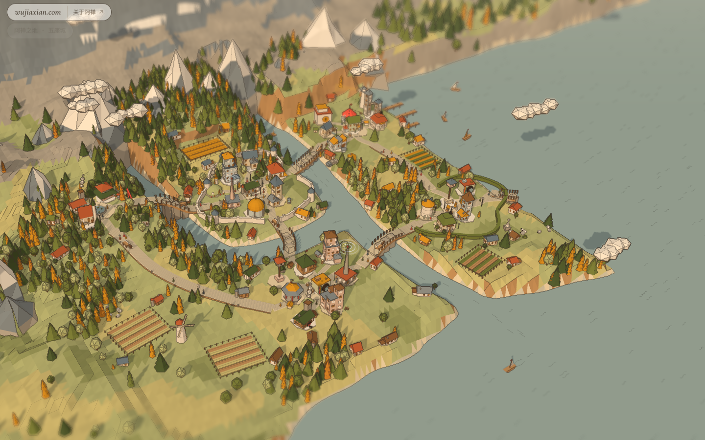
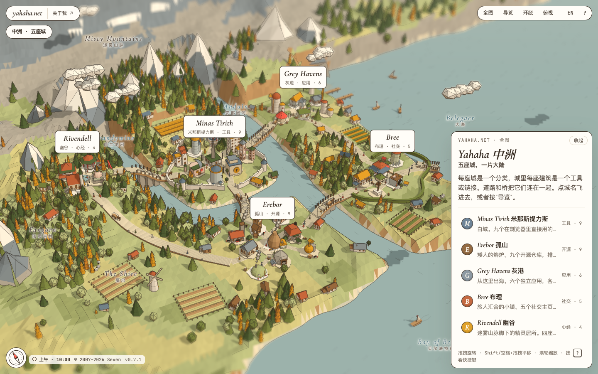
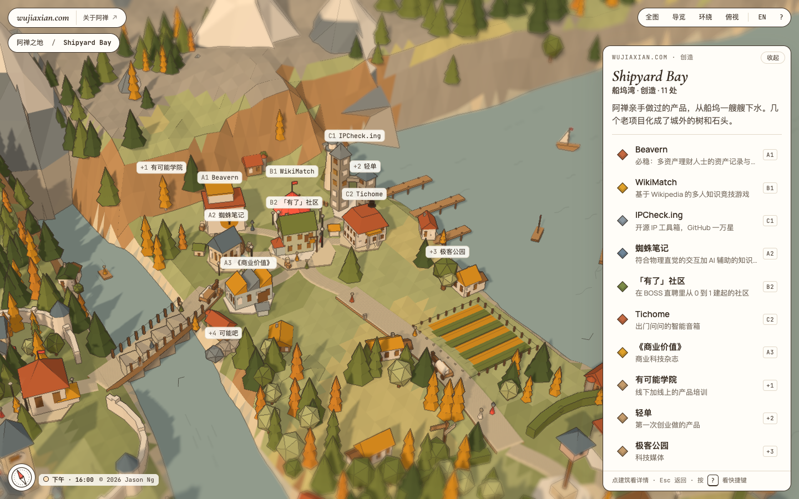

# site-to-map

An agent skill that turns a personal homepage, link-in-bio page or navigation site into a
**folded-paper 3D map**: every category becomes a town, every link a landmark building,
and links that don't need a building become trees, rocks or signposts you can still click.

It is the engine behind [yahaha.net](https://yahaha.net), extracted so any site can be
converted with one `site.json`.



## What you get

- A paper-craft continent drawn with three.js: terraced land, rivers with bridges, forests,
  fields, boats, travellers and ink-line edges.
- Up to five towns on fixed slots (walled centre, harbour, workshop quarter, market town,
  highland), nine buildings each and any number of props around them.
- 37 building shapes and 12 props, picked per link by meaning (a bot is a dovecote, an IP
  tool is two towers with a sky bridge, a blog is a clock tower).
- Light, sky and street lamps follow the visitor's local time across eight phases; the
  interface colours follow too.
- Chinese and English, guided tour, orbit and top views, keyboard shortcuts, Shift/Space
  drag to pan, a no-JavaScript link list.

## Install

```bash
git clone https://github.com/dofy/site-to-map
cp -R site-to-map/skills/site-to-map ~/.claude/skills/        # Claude Code
cd ~/.claude/skills/site-to-map && npm install                # Playwright for extract/check
```

For other agents, put `skills/site-to-map` wherever they load `SKILL.md` skills from.

## Use

Ask your agent: *"Turn https://example.com into a site-to-map page."* The skill extracts the
page, plans the towns, writes `site.json`, builds and screenshots it. By hand:

```bash
node scripts/extract.mjs https://example.com extract.json   # sections and links
# write site.json (see references/site-schema.md and examples/)
node scripts/build.mjs site.json out                        # standalone out/index.html
node scripts/check.mjs out                                  # screenshots + problems in out/_check
```

Serve `out/` over HTTP (ES modules don't load from `file://`).

## Examples

| | |
|---|---|
| [`examples/yahaha`](examples/yahaha/site.json) — the reference site, Tolkien fan naming chosen by its owner |  |
| [`examples/wujiaxian`](examples/wujiaxian/site.json) — [wujiaxian.com](https://wujiaxian.com/) with original names; four older projects became props |  |

## Layout

```
skills/site-to-map/
├── SKILL.md                 workflow and rules for the agent
├── engine/                  map-engine.js (three.js), map.css, template.html
├── references/              site-schema.md, site.schema.json, kinds.json (shape catalogue)
└── scripts/                 extract.mjs, build.mjs, check.mjs
examples/                    site.json for yahaha.net and wujiaxian.com
```

## License

MIT. three.js is MIT and is loaded from jsDelivr by the standalone page. Fonts (Manrope,
JetBrains Mono, Cormorant Garamond) are under the SIL Open Font License.
