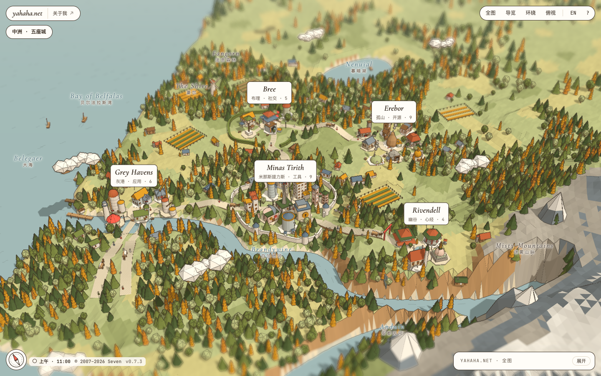
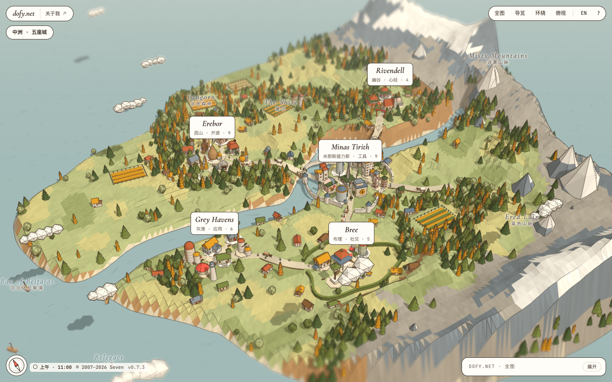
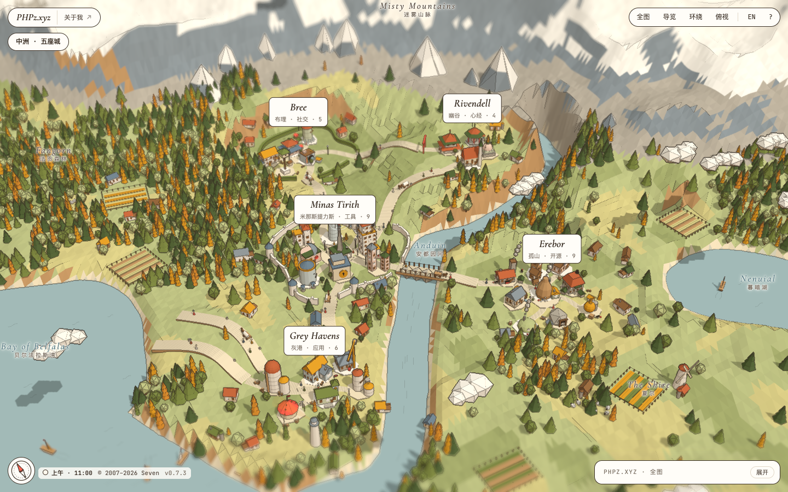
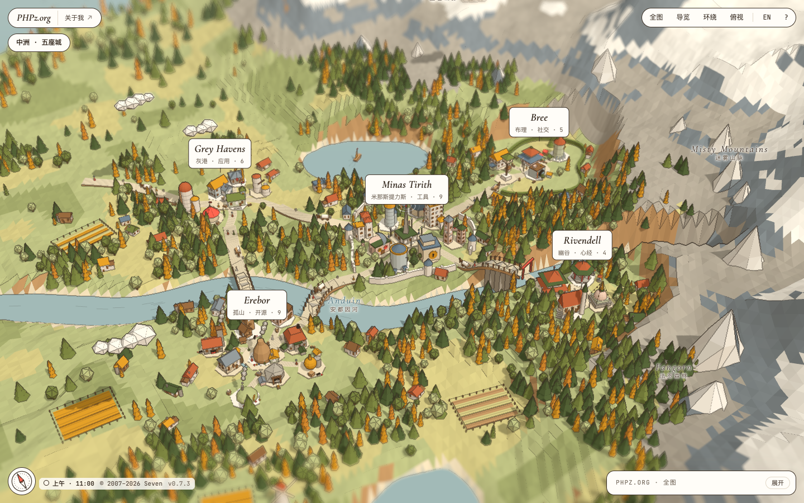

# site-to-map

An agent skill that turns a personal homepage, link-in-bio page or navigation site into a
**folded-paper 3D map**: every category becomes a town, every link a landmark building,
and links that don't need a building become trees, rocks or signposts you can still click.

It is the engine behind [yahaha.net](https://yahaha.net), extracted so any site can be
converted with one `site.json`.



## What you get

- A paper-craft world drawn with three.js and **generated from a seed**: five world types
  (coast, two coasts, island, gulf, lakeland), one or two mountain ranges, rivers, lakes,
  roads with bridges, forests, fields, boats, travellers and ink-line edges. Each site gets
  its own land; `?seed=` and `?world=` preview others.
- Three to nine towns placed by role (walled centre, harbour, workshop quarter, market
  town, highland, then any number of plain towns), nine buildings each and any number of
  props around them. More than five towns grows the world to fit.
- 37 building shapes and 12 props, picked per link by meaning (a bot is a dovecote, an IP
  tool is two towers with a sky bridge, a blog is a clock tower).
- Light, sky and street lamps follow the visitor's local time across eight phases; the
  interface colours follow too.
- Guided tour, orbit and top views, Shift/Space drag to pan, a no-JavaScript link list.
- Optional (off by default): a Chinese/English switch and keyboard shortcuts. Tour, view
  buttons, clock, compass, fixed daylight, entrance animation, motion and blur can be
  switched in `site.json` → `ui`.

## Install

Tell your agent:

> Install the site-to-map skill from https://github.com/dofy/site-to-map

Or install it yourself:

```text
/plugin install site-to-map --marketplace dofy/site-to-map    # Claude Code 2.1.275+
npx skills add dofy/site-to-map                               # Codex, Cursor and other agents
```

The skill installs its own script dependency (Playwright, for reading pages and taking
screenshots) the first time it runs.

## Use

Give the agent a site and say what you want:

> Turn https://example.com into a site-to-map page.

> Make my bookmarks (bookmarks.html) into a map with four towns, an island world and a Chinese/English switch.

The agent reads the site, plans the towns, names them, picks a building for every link,
generates the land, builds a standalone page and checks it with screenshots. It tells you
what it merged or turned into props, and you can ask for changes the same way:

> Put GitHub and the blog in one town. Try another seed. Turn on keyboard shortcuts.

Serve the output folder over HTTP to open it (ES modules don't load from `file://`).
Options worth knowing, all optional: number or grouping of towns, `world.type` and
`world.seed` (including `"{domain}"` for one land per domain), `ui.languageSwitch` and
`ui.shortcuts` (off by default), and the rest of `ui` (see
[`references/site-schema.md`](skills/site-to-map/references/site-schema.md)).

<details>
<summary>Running the scripts by hand</summary>

```bash
cd <skill folder> && npm install                            # once
node scripts/extract.mjs https://example.com extract.json   # sections and links
# write site.json (see references/site-schema.md)
node scripts/build.mjs site.json out                        # standalone out/index.html
node scripts/check.mjs out                                  # screenshots + problems in out/_check
```

</details>

## One site, four worlds

[yahaha.net](https://yahaha.net) is served on four domains with `"seed": "{domain}"`, so one
`site.json` grows a different world on each: a western coast, an island, a gulf with a
lake, and a landlocked lake country. Same towns, same buildings, different land.

| | |
|---|---|
| [yahaha.net](https://yahaha.net)  | [dofy.net](https://dofy.net)  |
| [PHPz.xyz](https://phpz.xyz)  | [PHPz.org](https://phpz.org)  |

Its full config is [`src/data/map.json`](https://github.com/dofy/yahaha/blob/main/src/data/map.json)
in dofy/yahaha.

## Layout

```
skills/site-to-map/
├── SKILL.md                 workflow and rules for the agent
├── engine/                  map-engine.js (three.js), world-gen.js, map.css, template.html
├── references/              site-schema.md, site.schema.json, kinds.json (shape catalogue)
└── scripts/                 extract.mjs, build.mjs, check.mjs
.claude-plugin/               Claude Code plugin and marketplace manifests
docs/                        README screenshots
```

## License

MIT. three.js is MIT and is loaded from jsDelivr by the standalone page. Fonts (Manrope,
JetBrains Mono, Cormorant Garamond) are under the SIL Open Font License.
