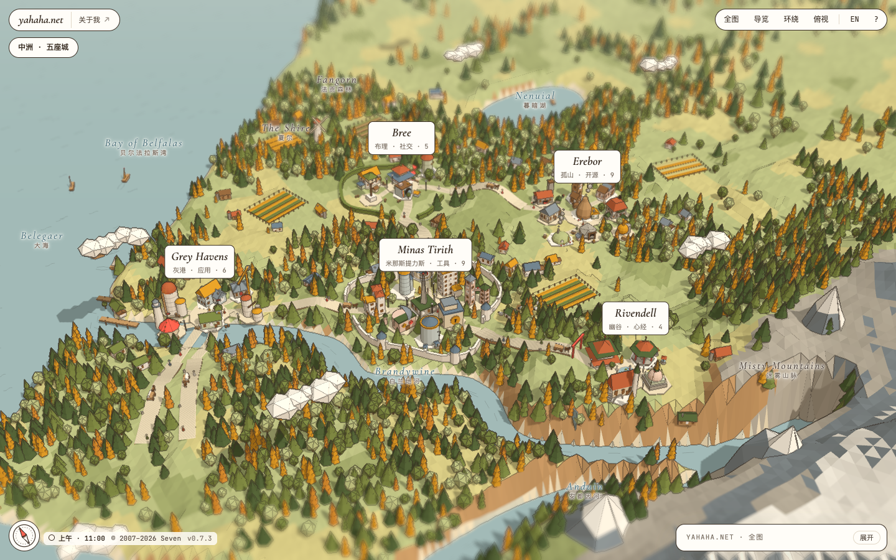
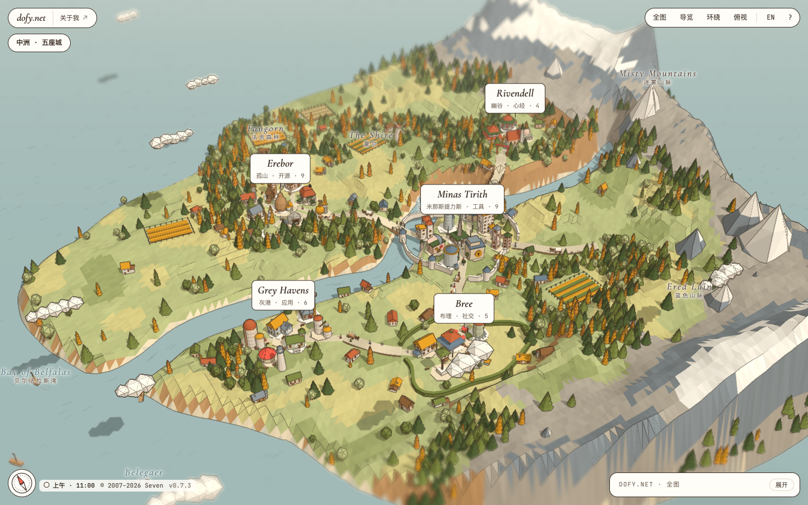
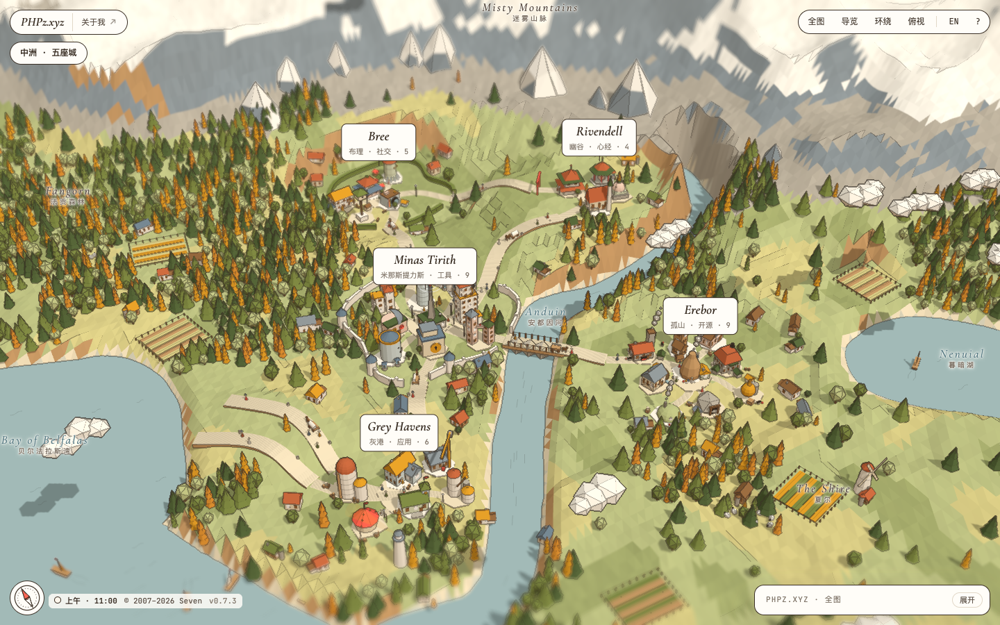
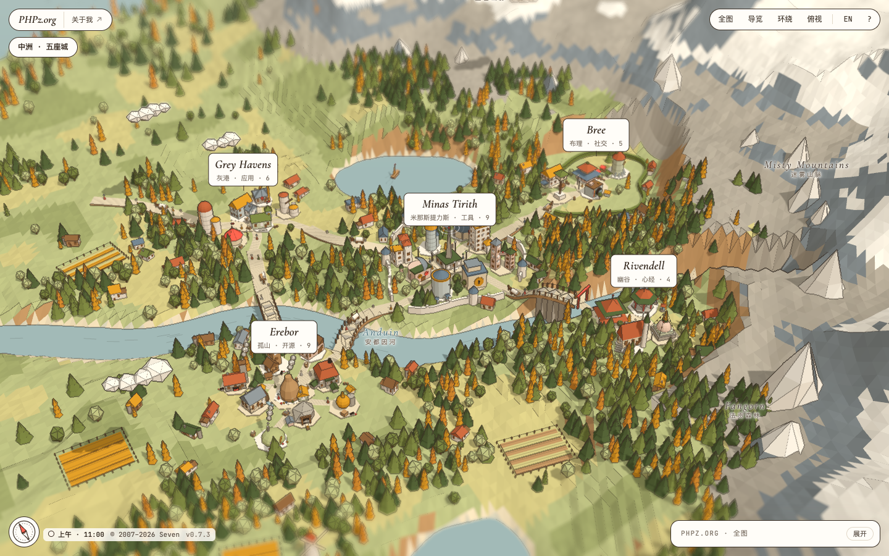

# site-to-map

[English](README.md) | 简体中文

一个 agent skill，把个人主页、link-in-bio 页面或导航站变成一张**折纸风 3D 地图**：每个分类是一座城，每个链接是一座地标建筑；不需要建筑的链接会变成树、石头或路牌，照样可以点击。

它是 [yahaha.net](https://yahaha.net) 首页背后的引擎，单独提取出来后，任何网站只要一份 `site.json` 就能转换。



## 能得到什么

- 用 three.js 画的纸模型世界，**由种子生成**：五种地形类型（单面海岸、两面临海、岛屿、海湾、湖区），一到两条山脉，河流、湖泊，带桥的道路，森林、农田、船、行人和墨线描边。每个站点都有自己的一片地形，`?seed=` 和 `?world=` 可以预览别的地形。
- 3 到 9 座城按角色摆放（有城墙的中心城、港口、工坊街、集市、高原，以及任意数量的普通城），每座城最多 9 栋建筑，城外可以再放任意数量的道具。超过 5 座城时，世界会自动放大。
- 37 种建筑和 12 种道具，按链接的含义挑选（机器人是鸽舍，IP 工具是两栋楼加一座连桥，博客是钟楼）。
- 光照、天色和路灯跟随访客的本地时间，一天分 8 个时段，界面配色也随之变化。
- 开场从海上看向内陆，并避开挡住城镇的山峰；城与城之间镜头沿弧线飞行，“全图”按钮回到这个初始视角。
- 导览、环绕和俯视视角，按住 Shift 或空格拖拽平移，禁用 JavaScript 时显示链接列表。
- 站名旁可以放几个站点级链接（GitHub、博客、邮箱等），带图标，手机上只显示图标。
- 按网站自己的语言生成。界面文字内置简体中文、繁体中文、日语和英语，其他语言的界面文字写在 `site.json` 里。引擎也能在你手动添加的多种语言之间切换，但 skill 本身不做翻译。
- 可选（默认关闭）：快捷键。导览、视角按钮、时钟、罗盘、固定时刻、开场动画、动态效果和景深模糊都可以在 `site.json` → `ui` 里开关。

## 安装

把这句话发给你的 agent：

```text
Install the site-to-map skill from https://github.com/dofy/site-to-map
```

也可以自己装：

```text
/plugin install site-to-map --marketplace dofy/site-to-map    # Claude Code 2.1.275+
npx skills add dofy/site-to-map                               # Codex、Cursor 等其他 agent
```

skill 第一次运行时会自动安装脚本依赖（Playwright，用来读取网页和截图）。

## 使用

给 agent 一个网站，说出你的要求：

```text
把 https://example.com 转换成 site-to-map 页面。
```

```text
把我的书签（bookmarks.html）做成地图，分成四座城，用岛屿地形。
```

agent 会读取网站、规划城镇、起名、为每个链接挑选建筑、生成地形、构建独立页面，并截图检查。它会告诉你哪些内容被合并了，哪些变成了道具。想调整，继续用同样的方式说：

```text
把 GitHub 和博客合成一座城。换一个种子。打开快捷键。
```

生成的文件夹要通过 HTTP 服务打开（ES 模块不能从 `file://` 加载）。值得知道的可选项：城的数量或分组，`world.type` 和 `world.seed`（包括按域名生成地形的 `"{domain}"`），`site.links`，`ui.shortcuts`（默认关闭）以及 `ui` 的其他选项。手动添加多语言的方法见 [`references/site-schema.md`](skills/site-to-map/references/site-schema.md) 的 *Languages* 一节。

<details>
<summary>手动运行脚本</summary>

```bash
cd <skill 目录> && npm install                               # 只需一次
node scripts/extract.mjs https://example.com extract.json   # 提取小节和链接
# 编写 site.json（见 references/site-schema.md）
node scripts/build.mjs site.json out                        # 生成独立页面 out/index.html
node scripts/check.mjs out                                  # 截图并报告问题，结果在 out/_check
```

</details>

## 一个站点，四片世界

[yahaha.net](https://yahaha.net) 同时挂在四个域名上，用的是 `"seed": "{domain}"`，所以同一份 `site.json` 在每个域名上长出不同的世界：西海岸、岛屿、带湖的海湾、内陆湖区。城和建筑都一样，地形各不相同。

| | |
|---|---|
| [yahaha.net](https://yahaha.net)  | [dofy.net](https://dofy.net)  |
| [PHPz.xyz](https://phpz.xyz)  | [PHPz.org](https://phpz.org)  |

完整配置见 dofy/yahaha 仓库里的 [`src/data/map.json`](https://github.com/dofy/yahaha/blob/main/src/data/map.json)。

## 目录结构

```
skills/site-to-map/
├── SKILL.md                 给 agent 的工作流程和规则
├── engine/                  map-engine.js（three.js）、world-gen.js、map.css、template.html
├── references/              site-schema.md、site.schema.json、kinds.json（造型目录）
└── scripts/                 extract.mjs、build.mjs、check.mjs
.claude-plugin/               Claude Code 插件和 marketplace 清单
docs/                        README 截图
```

## 许可

MIT。three.js 采用 MIT 许可，独立页面从 jsDelivr 加载。字体（Manrope、JetBrains Mono、Cormorant Garamond）采用 SIL Open Font License。
